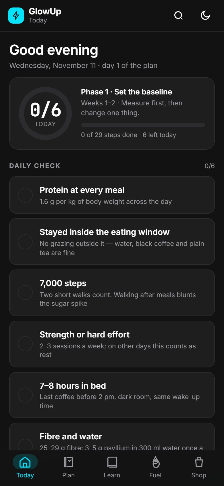

# GlowUp — Men's Transformation Library (static PWA)

A mobile-first, installable **static** site generated from the Phase-1 Markdown library in
`../research/` (files `00`–`26`). No backend, no build step at runtime, no CDN dependencies:
every asset is local and cached by a service worker.

| | |
|---|---|
| **Articles** | 38, across 12 categories, each graded and citation-linked (de-duplicated: one shared safety block per cluster, no repeated lines) |
| **Products** | 18, of which **12 have prices verified on iHerb (1 Nov 2026)** with cost-per-serving maths |
| **Nutrition** | 26 USDA FoodData Central entries (kcal, protein, fibre, water, satiety evidence) |
| **Meals** | 5 templates + 7-day rotation + one-page shopping list (persisted) |
| **Stack** | Vanilla ES2019 + Tailwind 3 (compiled locally) + shadcn/ui-style primitives |
| **Reader** | Read-aloud narration + saved text highlights on every article (free device voices) |
| **Photography** | 33 photographs — hero, 11 library sections, four food groups, five meal templates, article library, ten guide pages — inlined as data URIs |
| **Voice** | Human-voice editorial copy layer + narration with breath groups and real pauses |
| **Design** | Apple design system (`DESIGN.md`): 17 px body, SF Pro stack, 18 px cards, pill buttons, zero decorative gradients or UI shadows |
| **Size** | 29 KB CSS · 73 KB JS · 165 KB data · 867 KB photos — **no external requests** |



---

## 0. Single-file build (no server, no install)

`glowup-standalone.html` (**2.03 MB**) is the entire app — markup, compiled CSS, JS, the full data
layer and an inline SVG icon — in **one file with zero external requests**. Double-click it, or
send it to a phone; it works from `file://`, offline, with no server and no build step.

* Everything the hosted build does works here: 38 articles, filters/sorting, live search, detail
  sheets, dark mode + shopping list persistence (`localStorage` works on `file://` in Chrome,
  Firefox and Safari).
* **PWA caveat:** browsers require a manifest and a service-worker file served from an origin, so
  *installability* is a hosted-only feature. The standalone file is offline by construction; on
  iOS/Android use the browser's “Add to Home Screen” (it keeps working offline because there is
  nothing to fetch).
* Regenerate it any time with `npm run build:standalone` (runs after `npm run build`).

| Build | Files | Best for |
|---|---|---|
| `glowup-standalone.html` | **1** | Emailing, USB, phone download, opening offline, embedding |
| `index.html` + `assets/` + `data.js` + `sw.js` | 12 | Hosting; adds installability, service-worker caching, app shortcuts |

---

## 1. Quick start

```bash
# simplest: any static server (service workers need http:// or https://, not file://)
cd glowup
python3 -m http.server 8080 --bind 0.0.0.0    # or: npm run serve
# → http://localhost:8080
```

Opening `index.html` directly from disk also renders the whole app; only the service worker
(offline/PWA) is skipped, because `file://` is not a secure context.

Rebuild after editing content or styles:

```bash
npm install               # tailwindcss + playwright-core (dev only)
npm run build             # art.py → extract.py → data.js → assets/app.css
npm run build:standalone  # → dist/glowup-standalone.html (single file)
npm run watch:css         # while editing styles
npm test                  # headless PWA + interaction tests (dev/pwa-test.js)
npm run test:queries      # sort / filter / search behaviour across every surface
npm run test:standalone   # the single-file build, loaded from file://
npm run test:e2e          # drives the real UI (tabs, Big D, read-aloud, summary)
npm run test:design       # the rendered design tokens, both themes
npm run test:docs         # the README's counts, links and screenshots
npm run test:all          # all of the above
npm run shots:docs        # regenerate the README screenshots from the real UI
```

---

## 2. Structure

```
glowup/
├── index.html              # app shell: header, 5 views, search overlay, detail sheet, bottom nav
├── assets/
│   ├── app.css             # compiled Tailwind + shadcn-style component layer (generated)
│   └── app.js              # all app logic: router, views, filters, search, sheets, PWA
├── data.js                 # window.GLOWUP_DATA — generated data layer (do not hand-edit)
├── data.json               # same data, human-readable intermediate
├── extract.py              # Markdown → structured data pipeline (the only source of content)
├── src/input.css           # Tailwind entry: design tokens + component primitives
├── tailwind.config.js      # token mapping, dark mode via .dark class
├── manifest.webmanifest    # PWA manifest (icons, shortcuts, standalone)
├── sw.js                   # service worker: precache shell, offline-first
├── icons/                  # 192/512/maskable/apple-touch + og-image
├── art.js                  # all photographs as data URIs (generated by art.py)
├── copy.js                 # human-voice copy: hero, intros, 33 hooks, reader hints
├── guides.js               # window.GLOWUP_GUIDES — 6 long-form guide pages
├── plan.js                 # window.GLOWUP_PLAN — blueprint phases, daily check, tasks
├── topics.js               # window.GLOWUP_TOPICS — the Library: 4 sections, 19 topics
├── art/                    # art/photo (build sources) + art/illustrations (archived vector set)
├── art.py                  # illustration pipeline → art.js
├── build_standalone.py     # inlines everything into dist/glowup-standalone.html
├── dev/                    # Playwright checks: PWA, standalone, reader, preview health, screenshots
│   target.js             # resolves which build a dev script drives (no hardcoded paths)
└── docs/                   # JPEG screenshots used in this README
```

---

## 3. Data layer

`data.js` assigns one frozen-shaped object to `window.GLOWUP_DATA`. The app never fetches at
runtime — which is why it works fully offline and instantly on a slow connection.

```js
window.GLOWUP_DATA = {
  meta: {
    app, tagline, built, sources, priceVerifiedOn, disclaimer,
    counts: { articles: 38, categories: 12, products: 18, nutrition: 26, meals: 5 }
  },
  categories: [{ id, name, blurb }],           // 11
  articles: [{
    id, title, category, subtitle,
    grade,                                     // High | Moderate–High | Moderate | Low–Moderate | Low
    summary: [htmlString],                     // "what the evidence establishes"
    points:  [htmlString],                     // key points
    safety:  [htmlString],                     // contraindications
    evidenceTable: [{ claim, grade, why }],    // parsed from each file's §3 table
    references: [{ author, title, journal, year, url }],
    source,                                    // which Markdown file it came from
    readMinutes, words
  }],
  products: [{
    id, name, brand, category,                // fibre | creatine | vitamin-d | protein | device
    price, priceVerified,                      // null price when not verified — never invented
    sizeG, serveG, servings,
    costPerServing, costMath,                  // "$21.31 ÷ 136 servings (680 g ÷ 5 g) = $0.157/serving"
    evidence, purpose, use, risks, contra, note, tier,
    links: [                                    // iHerb + Amazon ONLY
      { vendor: "iHerb",  kind: "product" | "search", url },
      { vendor: "Amazon", kind: "search",             url }
    ],
    url                                         // = the iHerb link (primary)
  }],
  nutrition: [{
    id, name, fdcId, kcal, protein, fibre, water,
    proteinPer100kcal, fibrePer100kcal, gPer100kcal, satiety, group
  }],
  meals: [{ id, slot, name, protein, fibre, note, items: [string] }],
  rotation: [["Mon", breakfast, lunch, dinner], …],
  shopping: [["Protein", [items…]], ["Fibre & vegetables", […]], …]
}
```

### How each part is produced (`extract.py`)

| Part | Method |
|---|---|
| **Articles (33)** | 25 whole-file articles + 9 articles split out of specific `##`/`###` sections (e.g. `02 §2.2/2.5/2.7` → “How fast is too fast”). Text is pulled from the file's *Executive summary*, *What the evidence establishes* (paragraphs, bullets **and** table rows — table cells become readable lines) and *Safety and contraindications*. |
| **Grade** | The modal grade token found inline in the article's own text (`— Moderate`, `High`); falls back to the file's §3 evidence table. No grade is assigned by hand. |
| **References** | Parsed from each file's `## 13. Verified references` list (author, title, journal, year, URL). Every article on the site links its sources directly. |
| **Products (18)** | 12 iHerb SKUs whose prices were verified in the Phase-1 research session, plus 6 catalogue entries from `18 §10.5–10.11` that are **explicitly not price-verified** (the UI shows “Not price-verified” and no price). |
| **Product destinations** | **Only two vendors: iHerb and Amazon.** iHerb is a real product page when the price was verified, otherwise an iHerb search; Amazon is *always* a search link, labelled as such, and **no Amazon price is ever shown**. Generated per product as `links[{vendor, kind: product|search, url}]`. |
| **Cost per serving** | Computed: `price ÷ (packSize ÷ servingSize)`, and the formula is printed in the UI so it can be checked. Vitamin D counts use `softgels` as the unit, not grams. |
| **Nutrition (26)** | Queried from the offline USDA **SR Legacy** dataset (7,794 foods, 644,126 nutrient rows) by exact description, then kcal/protein/fibre/water and derived ratios are stored with the FDC ID for traceability. |
| **Meals** | The five templates from `26 §7` plus the 7-day rotation and weekly shopping list. |
| **Phase-1 guard** | Phase-1 and Phase-2 files share numbering prefixes (`02_FAST_FAT_LOSS.md` vs `02_Hunger_Control_and_Satiety.md`). The extractor only accepts ALL-CAPS stems — i.e. Phase 1 — so the site can never silently read the wrong file. |

**Nothing on this site is written by hand into the HTML.** If a fact is not in the Markdown or the
USDA dataset, it does not appear.

---

## 4. Design system " + EM + " WattVision tokens on shadcn/ui primitives in plain CSS

The shipped interface is the **WattVision** system (§10h): a technical-monitoring look with
hairline borders instead of shadows, one cyan accent for data and actions, lime for live/normal
and red for alerts, Inter for text and JetBrains Mono for every number that matters. It is
implemented as Tailwind tokens over shadcn/ui primitives in plain CSS — no framework runtime.

```bash
npm run test:design   # asserts the rendered tokens in both themes
npm run shots:design  # screenshots of every main view in both themes
```


Tailwind is compiled locally with the **shadcn/ui token contract** (HSL CSS variables, `.dark`
class strategy). Because the site ships no React runtime, the primitives are hand-ported to
component classes with the same names, variants and states — so markup reads like shadcn:

| shadcn/ui primitive | Implementation | Variants / notes |
|---|---|---|
| `Button` | `.btn` + `.btn-default`/`-secondary`/`-outline`/`-ghost`/`-destructive`, `.btn-sm/-lg/-icon` | 40 px min touch target |
| `Card` | `.card`, `.card-header`, `.card-title`, `.card-description`, `.card-content`, `.card-footer` | soft elevation token |
| `Badge` | `.badge` + `-default`/`-secondary`/`-outline`/`-success`/`-warning`/`-danger` | grade badges use data colours |
| `Input` | `.input`, `.select`, `.no-ring` | 44 px tall on mobile |
| `ToggleGroup` / `Tabs` | `.chip` + `aria-pressed`, `.segmented` + `aria-pressed` | real ARIA state, keyboard operable |
| `Sheet` / `Dialog` | `.sheet`, `.overlay`, `.sheet-handle`, focus trap + `Esc` + focus restore | bottom sheet on mobile |
| `Accordion` | `.accordion-trigger[aria-expanded]` / `.accordion-panel` | CSS-only indicator |
| `Switch` | `.switch[aria-checked]` | used for “Verified prices only” |
| `Separator` | `.separator` | |
| `Skeleton` | `.skeleton` (shimmer keyframes) | used during first paint |
| `ScrollArea` | `.chip-row`, `.hide-scrollbar` | edge-to-edge chip rows |
| `Progress` | `.bar > span` | macro bars, shopping progress |
| `Sonner`/`Toast` | `#toast` + `aria-live="polite"` | install, list-cleared messages |

Tokens: `--background`, `--foreground`, `--card`, `--primary`, `--secondary`, `--muted`,
`--accent`, `--destructive`, `--border`, `--input`, `--ring`, `--radius`, plus five grade colours
(`--grade-high` … `--grade-low`). Light and dark are complete, independent palettes.

---

## 5. Features

| Feature | Where | Detail |
|---|---|---|
| **Bottom navigation** | `index.html` + `setView()` | 5 tabs (Today · Blueprint · Learn · Fuel · Shop), `aria-current="page"`, hash routing (`#library`, `#plan`…), last view restored |
| **Library with tabs + sub-tabs** | `renderLibrary()` | Learn opens the Library: 4 section tabs (Health · Fitness · Lifestyle · Mind) over 19 topic sub-tabs, each topic its own page with a reader, deeper reading and kit |
| **Library reader** | `mountInlineReader()` | Same listen/highlight engine as articles and guides, mounted on every topic page (`topic:<id>` keys, separate highlights) |
| **Category filter** | `renderArticles()` | 11 category chips with live counts + “All” |
| **Sort toggles** | articles / food / products | Articles: Evidence · A–Z · Shortest · Category. Food: Protein · Fibre · Volume · Low kcal · A–Z. Products: Cost/serving · Price · Evidence · A–Z |
| **Additional filters** | — | Grade `<select>` (degrades gracefully), food-group chips, product-category chips, **Verified prices only** switch |
| **Live search** | `searchAll()` / `renderSearch()` | Single index over 19 library topics, 6 guides, 38 articles, 26 foods, 18 products, 5 meals and the shopping list. Scoped chips (Everything/Library/Guides/Articles/Food/Products/Meals), grouped results, result count announced via `aria-live`, opens with `/` or `⌘/Ctrl-K`, `Esc` closes; a topic result deep-links into `#library` |
| **Dark mode persistence** | head script + `setTheme()` | Restores from `localStorage` **before first paint** (no flash), falls back to `prefers-color-scheme`, updates `<meta name="theme-color">` |
| **Detail sheets** | `openArticle()` / `openProduct()` | Grade + read time, evidence bullets, evidence-quality table, safety block, full citation list with outbound links |
| **Shopping list** | `renderMeals()` | Checkboxes, strikethrough, progress bar, counter (e.g. “2/27 checked”), state persisted in `localStorage` |
| **PWA** | `manifest.webmanifest`, `sw.js` | Installable (own install button when `beforeinstallprompt` fires), standalone display, app shortcuts, offline banner |
| **Read-aloud reader** | `mountReader()` | Per-article bar: Listen/Pause/Resume, Stop, speed (0.85–1.5×), voice picker, live `12/57` position. The spoken sentence is highlighted and auto-scrolled into view. |
| **Text highlighter** | `highlightSelection()` | Select any text → floating **Highlight** button marks every sentence it touches; tap a highlight to delete it; “Highlighted N” opens the list with per-item ✕ and “Clear all”. Saved per article in `localStorage`, so it survives reloads and reopens. |
| **Accessibility** | throughout | Skip link, focus trap in dialogs, focus restore, visible focus rings (except the full-width search field), `aria-pressed` chips, `aria-live` statuses, reduced-motion support, 40–44 px targets |

---

## 6. Photography and voice

### Photographs

Thirteen images, one per surface: the home hero, all 11 category tiles, and the section banners
for Food, Products, Meals and Articles. Every one is **inlined as a data URI** (`art.js`), so the
bundle stays self-contained and offline.

**Why they look like stock photography but aren't watermarked:** searching the open web for stock
returns commercial previews — Dreamstime, 123RF and Getty files come back with the library's
watermark across the frame, which makes them unusable and unlicensed. So:

* **10 frames are generated for GlowUp** in a single photographic style (natural light, muted
  warm-neutral palette, 35 mm, shallow depth of field) — no watermark, no licence to negotiate.
* **3 frames are genuine free-licence photographs** from **Pexels** and **Unsplash**, which both
  allow commercial use without attribution: `foundations` (Pexels 33936499), `maintenance`
  (Unsplash road/horizon), `skin` (Pexels hand-cream search). They are credited in-app on the home
  screen and listed in `art.py`.
* If you have a paid stock subscription, drop licensed files into `art/photo/` with the same
  names and run `python3 art.py` — nothing else changes.

Pipeline: `python3 art.py` → `art/photo/*.jpg` (900 px masters) → 640–720 px, JPEG q68, base64 →
`art.js` (~867 KB for 23 images, ~38 KB each). The earlier vector set is archived, unused, in
`art/illustrations/`.

### Editorial voice (`copy.js`)

The app used to read like a research abstract. It now talks like a person — and that voice lives
in **one file, separate from the facts**:

* `copy.js` holds the hero, every section intro, every empty state, the disclaimers, the reader
  hints and **a one-line hook for each of the 38 articles** (e.g. *“Five numbers worth tracking.
  Most of the panel you've been sold isn't.”*).
* `data.js` still contains only what was extracted from the Markdown — grades, points, safety
  notes, citations. Nothing in the copy layer claims a new number, so provenance is untouched:
  the hook is GlowUp's framing, the graded content underneath is the research.
* Hooks appear on the article card, in the reader sheet as a highlighted callout, and are read
  aloud with the article.

Regenerate `copy.js` by hand only — it is written, not extracted.

---

## 7. Reader: read-aloud + highlighting

Open any article → the bar at the top of the sheet reads it out.
Open any **guide** → the *Listen* bar sits under the sub-tabs and reads the whole page.

The reader is shared by both surfaces — same voices, same speed setting, same highlight
storage — but the mounting differs: articles mount inside the sheet (`#sheet-body`), guides
mount inline over `#guide-content` (`mountGuideReader()`), because a guide is a view, not a sheet.

| | |
|---|---|
| **Natural pacing** | Before speaking, text is normalised for a voice: `e.g.` → *for example*, `vs` → *versus*, `~` → *about*, `%` → *percent*, `kcal` → *kilocalories*, `kg`, `mg`, `µg`, `IU`, `BMI`, `PSA`, `HbA1c`, `ApoB`, `GLP-1` and `D3` spelled the way they're said, dashes turned into commas. Long sentences are split at commas into **breath groups** (≤150 characters) so the engine never runs out of air. Between sentences the app **waits**: 130 ms inside a paragraph, ~380 ms between bullets, ~620 ms before a heading, 90 ms between breath groups — that rhythm is what makes it sound read-aloud rather than machine-gunned. |
| **Engine** | The browser's own `SpeechSynthesis` API — the voices already installed on the device (Windows/Microsoft, macOS/Apple, Android, iOS). **Free, no key, no server, no streaming**; local voices work with the network off and no text ever leaves the device. |
| **“Premium” voices** | The picker is ranked so the best-sounding free voices come first: *Natural / Neural / Enhanced / Siri / Google* voices are scored highest, then device-local voices, then others. Each is labelled `· premium`, `· online` (needs a connection) or nothing. Offline, online-only voices are pushed to the bottom automatically. |
| **Highlighting while reading** | Every block of body text is split into sentence atoms (`.s`) at open time, so the sentence being spoken gets a violet wash and is scrolled into view. Abbreviations (`e.g.`, `i.e.`, `vs.`, initials) are kept inside their sentence. Citations and the footer are excluded from narration. |
| **Your own highlights** | Select text (drag, or long-press on mobile) → a **Highlight** button appears → it marks every sentence the selection touches, which is saved as an index array per article. Tap a highlighted sentence to remove it. |
| **Persistence** | `glowup:hl:<articleId>` (indices), `glowup:reader.rate`, `glowup:reader.voice` in `localStorage`. |
| **Accessibility** | Real buttons with labels, `aria-pressed` on Play, `aria-expanded` on the highlights panel, marked regions stay in the normal reading order, and the player never steals focus from the sheet. |
| **Honest limits** | Voice quality depends entirely on what the device has installed (headless browsers and some Linux boxes have none — the picker says so). “Online” voices need a connection. Narration reads the article's summary, key points and safety notes — not the full Markdown file. |

Installing better free voices (no purchase, no account):
* **Windows 11/10** — Settings → Time & language → Speech → *Add voices* → pick “Natural” variants.
* **macOS/iOS** — System Settings → Accessibility → Spoken Content → System Voice → Manage Voices → download *Enhanced/Premium*.
* **Android** — Settings → Accessibility → Text-to-speech output → Google TTS → install more English voices.

---

### Reader on the Guides pages (Round 8 follow-up)

* **What is read:** kicker and tables are deliberately *not* read (a spoken table is noise);
  the page title, intro, three-fact strip, headings, paragraphs, lists, steps, eat/skip cards,
  callouts, photo captions and the closing disclaimer all are. Sources and the "read the
  evidence" cards are marked `data-noread`.
* **Length:** 54–83 sentences per page (about 5–8 minutes at 1×).
* **Tap to skip (`jumpTo`):** while a page is being read, tap any sentence — or the blank part of a
  paragraph, list item or heading, which counts as its first sentence — and narration jumps there
  and carries on. Tapping while idle does nothing, so scrolling can never start audio by accident;
  tapping a link, a control or your own selection is ignored. Same behaviour in article sheets.
* **Floating transport:** once the listen bar scrolls out of view, a small ⏮ / Pause / ⏭ / Stop pill
  floats above the bottom nav (`#guide-player`), so playback and sentence-by-sentence skipping are
  always reachable. It disappears when reading stops or when you leave the Guides tab.
* **Highlights are per page:** `glowup:hl.guide:<tabId>` — the fasting page's highlights do not
  appear on the insulin page.
* **No double-splitting:** re-mounting over the same DOM (sheet closed, tab returned to) reuses
  the existing `.s` spans via `content.dataset.marked`, so a sentence never nests inside itself.
* **No duplicate ids:** opening an article *from* a guide empties the guide's listen bar while the
  sheet is open and remounts it on close, so `#reader-play` and friends stay unique.
* QA: `dev/guides-reader-test.js` (all six pages, play/pause/stop, highlight + persistence,
  article-over-guide isolation) and `dev/jump-test.js` (tap-to-skip on a sentence and on a
  paragraph, prev/next, no audio on an idle tap, links ignored, article sheet parity) — zero
  console errors in both.

---

## 8. PWA / offline behaviour

`sw.js` precaches the app shell (11 URLs) on install and then:

* **Navigations** — network-first, falling back to the cached shell so a deep link like
  `#products` still resolves offline.
* **Static assets** — cache-first, then network (successful responses are added to the cache).
* **Third-party requests** (iHerb, USDA, Amazon) are never intercepted or cached.
* Bump `CACHE = "glowup-v5"` whenever a shell asset changes; old caches are deleted on activate.

---

## 9. Verification log (headless Chromium)

| Check | Result |
|---|---|
| **Standalone file** — `file://` load, all views | 38 articles / 26 foods / 18 products render, **0 external requests**, 0 errors |
| **Queries** " + "—" + " sort, filter and search (`npm run test:queries`) | category / grade / text filters match the data exactly; Evidence-first, A" + "–" + "Z and Shortest sorts are correctly ordered; cost-per-serving sort is ascending; verified-only matches the data; search spans Library, Guides, Articles and Products and reports an empty result honestly |
| **Docs** " + "—" + " the README against the build (`npm run test:docs`) | every count the README quotes matches the built data; every screenshot it links exists; the nine WattVision hexes are in the stylesheet |
| **Standalone file** — theme + shopping persistence on `file://` | dark default, toggle persists, `1/27 checked` survives reload |
| Console/page errors on load and across all views | **0** |
| Service worker | active, scope `/`, cache `glowup-v12` with **16** entries |
| Offline reload (`context.setOffline(true)`) | app renders fully; offline banner shown |
| Theme toggle → reload | dark survives reload (`localStorage`) |
| Shopping list check → reload | `2/27 checked`, 7 % progress, survives reload |
| Articles view | 33 cards, 17 chips, 4 sort toggles |
| Grade filter = High | 33 → **9** articles |
| Products | 18 listed, **12** with verified prices when the switch is on |
| Search “protein” | 35 results across 4 groups; “creatine” → 12; “vitamin d” → products group |
| **Photography** — 33 images: hero, library sections, food groups, meal templates, article library, guide pages | all decoded from data URIs (`naturalWidth > 0`), **0 external requests**, identical on the standalone file and the hosted build |
| **Copy layer** — all 33 hooks, intros, empty states | rendered from `copy.js`; article cards and sheets show the hook, data fields untouched |
| **Narration pacing** | sentence gaps 130/380/620 ms by block type, breath groups ≤150 chars, pauses cleared correctly on stop/pause |
| **Reader** — 57 sentence atoms on a test article, voice ranking, playback | premium voice auto-selected; Play advances sentence-by-sentence, counter `11/57`, Pause → Resume, speed change 1×→1.3× takes effect mid-article, Stop clears the highlight |
| **Highlighter** — selection → mark, tap → remove, panel, persistence | 3 sentences marked from a drag selection; tap removes one (3→2); re-opening the article restores 4 saved highlights |
| **Product links** — hosts across all 18 products | **iHerb + Amazon only** (`www.iherb.com`, `www.amazon.com`); 12 real iHerb product pages, 6 iHerb searches, 18 Amazon searches, 0 Amazon prices |
| **Reader bar** at 320 / 360 / 390 / 430 px | no row overflow, no document overflow |
| Horizontal overflow at 390 px | none (`scrollWidth === clientWidth`) |
| Cost-per-serving maths | `11.30 ÷ (340÷5) = $0.166`; `8.83 ÷ 240 = $0.037`; `105.00 ÷ (2270÷30) = $1.387` |
| **Library** — 4 section tabs × 19 topics (`dev/library-test.js`) | every topic renders an `h1`, ≥150 words, a reader bar and 0 horizontal overflow at 390 px; 4/4 section tabs, 19/19 sub-tabs select correctly |
| **Library reader** | play starts, sentence 5 of 22 highlighted and counted (`5/22`) on the Sleep topic; highlights saved per topic |
| **Library deep links** | a topic's first deep link opens the Guides view (`Making it your baseline`) |
| **Library search** | "sleep" returns 9 hits, library topics first |
| **One reader bar in the DOM** | the stray `#reader` / `#reader-voice` duplicates are removed on every mount, so the visible controls always own the ids |

Reproduce with `npm test` (needs a server on `:8123`, see `dev/pwa-test.js`).

---

## 10. Content provenance and honesty rules

* **Every claim links to its source** (PubMed or an official URL) in the article sheet.
* **Grades are extracted, not invented** — they come from the Markdown's own grading.
* **No price is fabricated.** 12 products show a verified iHerb price dated 1 Nov 2026; the other
  6 deliberately show “Not price-verified” and no number. Prices exclude shipping, customs and
  local markup.
* **Nutrition values** are USDA SR Legacy per 100 g with the FDC ID printed on every card; real
  food varies ±10–15 %.
* **No affiliate links, no tracking, no analytics, no third-party requests.** (Outbound product
  links leave the app only when you tap them, and go to iHerb or Amazon and nowhere else.)
* **Amazon is never priced.** Every Amazon destination is a search link and is labelled
  “Amazon · search”; the only price figure anywhere in the app is the iHerb one checked on
  1 Nov 2026.
* The disclaimer is shown on the home screen and repeats that this is research synthesis, not
  medical advice.

---

## 10b. Design system and content hygiene (Round 6)

**Apple design system (Round 6, since superseded).** This was the first pass and it has since
been replaced by the WattVision system in §10h — the palette, type scale and component rules
below describe what Round 6 changed, not what ships today. What it changed:

* **Type** — one stack (`-apple-system`/SF Pro), body 17 px at 1.47, caption 13 px, display
  28–40 px at weight 600 with −0.022 em tracking. No 500-weight, no second display face.
* **Colour** — canvas `#fff` (dark `#000`), parchment `#f5f5f7`, ink `#1d1d1f`, a single Action
  Blue `#0066cc` (`#2997ff` on dark). Decorative gradients were deleted; there are no accent
  colours beyond the five grade hues.
* **Surface** — 18 px radius cards with a 1 px hairline and **no shadow**; the one shadow in the
  app is the product-photo shadow on card thumbnails.
* **Controls** — pill buttons, minimum 44 px tall, `active:scale-0.95`; pill inputs, chips
  (2 px primary ring when pressed) and segmented controls; frosted `backdrop-filter` on the global
  nav, bottom nav, sheet and reader bar.
* **Photography** — full-bleed hero tile, 18 px banner strips, 64 px square thumbs on article and
  product rows, and a 150 px sheet photo. Every frame is inlined.

**Content hygiene.** `extract.py` now runs a de-duplication pass before writing `data.json`:

* Lines longer than 30 characters are compared after tag-stripping, lower-casing and
  whitespace-collapsing. The first article to contain a line keeps it; later articles drop it
  (57 duplicated blocks were removed across 12 article pairs).
* Articles that end up with no unique summary or points are merged into their parent, and the
  parent records `mergedFrom` (one case: *Supplement-by-supplement verdicts* → *Supplements*).
  The sheet shows that provenance only when the subtitle does not already name it.
* The shared safety cluster is stored once; the other eight articles carry `safetyRef` and render
  a “Safety and contraindications are shared with …” link that opens the owning article.

Screenshots of the finished surfaces live in `docs/`: `glowup-home.jpg`, `glowup-home-light.jpg`,
`glowup-library.jpg`, `glowup-guides.jpg`, `glowup-articles.jpg`, `glowup-article.jpg`,
`glowup-food.jpg`, `glowup-food-table.jpg`, `glowup-meals.jpg`, `glowup-products.jpg`,
`glowup-ledger.jpg`, `glowup-search.jpg`, `glowup-supplements.jpg`,
`glowup-fasting-claims.jpg`, `glowup-plan.jpg` (regenerate with `npm run shots:docs` —
it drives the real UI, so the images in this file can never show a UI the app no longer has).

---

## 10c. Detail views (Round 7)

The three data views now carry the whole record, not a summary of it.

**Products — two presentations of the same 18 rows.**

* *Buy list* — every SKU as a card: brand, pack size and dose basis, evidence grade, tier
  (budget / value / premium / tool), servings in the pack, cost per serving, what it is for, how to
  use it, the editorial note, and the two vendor links. Devices show “no consumable price”.
* *Supplement ledger* — the 12 supplements grouped into creatine, protein, fibre and vitamin D.
  Each group states what it is for, the grade, a one-paragraph verdict and cautions, then ranks
  every pack by **cost per serving** with a “Best value” flag on the cheapest. Six tools are listed
  in the buy list only, because there is nothing to re-buy.
* Both open the same full-detail sheet: purpose, dose, evidence, risks, contraindications, the
  cost-per-serving arithmetic printed as an equation, and the iHerb/Amazon rule restated.

**Foods — cards or a table.**

* *Cards* keep the satiety note and three bars (protein, fibre, grams per 100 kcal) and now add
  water %, protein per 100 kcal and fibre per 100 kcal.
* *Table* puts all 26 USDA rows on one screen: kcal, protein, fibre, grams per 100 kcal, with
  water % and the food group under each name. Tapping a row opens a sheet with all seven values
  and the FDC search link.

**Two bugs fixed on the way.**

1. Two creatine packs (CGN 1 lb and 1 kg) shared one truncated slug, so opening either showed the
   wrong product. `extract.py` now qualifies colliding slugs with the pack size and asserts that
   every product id is unique.
2. The product card printed “240 g pack · 1 g per serving” for softgels; pack text is now
   unit-aware (softgels vs grams).

Home also gained three quick links — Food table, Supplement ledger, Shopping list — so the deeper
views are one tap from the top.

Screenshots: `docs/glowup-products.jpg`, `docs/glowup-ledger.jpg`, `docs/glowup-food-table.jpg`.

---

## 10d. Guides tab (Round 8) — hand-written long-form pages

The bottom navigation gained a sixth tab, **Guides**, between *Articles* and *Food*. Guides are
written by hand (not generated from the research Markdown) because the request was for plain,
human-sounding English, and the research files are written for someone who already knows the words.

### Information architecture

    Guides (bottom nav)
      └── sticky sub-tab bar: Fasting · Refeed · Insulin & diabetes
                              Make it stick · Anti-ageing · Look younger
            └── one full page each: hero photo, 3-fact strip, prose, tables,
                callouts, an inline photo, related articles, numbered PubMed list

| id | label | title | words | tables | refs |
|---|---|---|---|---|---|
| `fasting` | Fasting | Fasting, without the fairy tales | 946 | 2 | 6 |
| `refeed` | Refeed | What to eat when the fast ends | 906 | 3 | 4 |
| `insulin` | Insulin & diabetes | Insulin resistance and type 2 diabetes | 1002 | 3 | 6 |
| `baseline` | Make it stick | Making it your baseline | 768 | 3 | 4 |
| `antiaging` | Anti-ageing | Slowing ageing: what actually works | 1007 | 3 | 6 |
| `younger` | Look younger | Looking younger, honestly | 848 | 2 | 4 |

### Content rules applied

* **Every technical word is defined where it first appears** — insulin resistance ("your cells stop
  listening to insulin"), HbA1c ("your three-month average blood sugar"), autophagy, ketones,
  creatine, retinoid, VO2 max.
* **Numbers over adjectives.** Claims carry a PubMed superscript; the reference list at the bottom of
  each page is numbered to match. The strongest single table is DiRECT's remission-by-weight-loss
  data (`insulin` page): 0/76 who gained weight went into remission, 86/100 of those who lost 15 kg
  or more did.
* **Honesty about nulls.** TREAT and TREAT-lite are on the fasting page, Look AHEAD's 8-year result
  is on the baseline page, and the anti-ageing page grades the supplement shelf down to "0 proven to
  extend human life".
* **Safety first where it matters.** Refeeding (hospital-grade risk after 36 h+), diabetes medication
  ("do not copy a trial at home"), finasteride, and fasting during pregnancy/illness all get explicit
  red callouts.

### Implementation

* `guides.js` — `window.GLOWUP_GUIDES.tabs`, a plain data array. Block types: `h`, `p`, `list`,
  `steps`, `table`, `do` (eat/skip), `facts`, `img`, `callout` (`key` / `tip` / `warn`).
  Inline tokens: `**bold**` and `[[n]]`, the latter becomes a superscript link to the matching
  PubMed entry.
* `assets/app.js` — `state.guides.tab`, `renderGuides()`, `guideBlock()`, plus a `[data-tab]`
  delegated handler. Guides are also indexed by the global search (`data-openguide`) so typing
  "insulin" jumps straight to that sub-tab.
* `src/input.css` — `.subtabs` (sticky at header height, horizontally scrolling), `.guide-table`,
  `.callout-*`, `.do-card`, `.cite`.
* Ten new photographs (`art/photo/guide-*.jpg`, 1264×848) are embedded as data URIs through
  `art.py` → `art.js`, so the single-file build stays self-contained (33 images, 1.37 MB of art).
* Service worker bumped to `glowup-v7` and now precaches `guides.js`.

### Verification (`dev/guides-test.js`, and `dev/guide-shots.js` for screenshots)

Six pages render with all sub-tabs, 2 images each (12 total, 0 broken), 0 page or console errors, no
horizontal overflow at 390 px, sticky sub-tab bar confirmed sitting at `top: 65px` under the frosted
header, every `a.cite` pointing at a real `pubmed.ncbi.nlm.nih.gov` record. Narrow-check passes at
320/360/390/430 px with six bottom-nav items.

## 10e. Round 9 — mobile-first redesign + Blueprint (UI/UX only)

The data layer, research, guides, products and every calculation are untouched. What changed is the
shell, the navigation, the visual system, and one new organising layer (`plan.js`).

### Information architecture (6 views → 5 tabs, nothing removed)

| Tab | Opens | Secondary navigation |
|---|---|---|
| **Today** | `#view-home` — new dashboard | — |
| **Plan** | `#view-plan` — **new** Blueprint screens | phase stepper (4 steps) |
| **Learn** | Guides *or* Articles (remembered) | segmented control in-view |
| **Fuel** | Foods *or* Meals & list (remembered) | segmented control in-view |
| **Shop** | Products (+ supplement ledger mode) | in-view modes |

`resolveNav()` maps a tab id to a concrete view, `setView()` still toggles the same `.hidden`
sections, and `#hash` routing now covers `plan` and both sub-views. Every previous route still
resolves (`#guides`, `#articles`, `#food`, `#meals`, `#products`), so bookmarks and the QA scripts
keep working.

### Blueprint (`plan.js`, new)

Hand-written structure, not generated content: 4 phases (Weeks 1–2 baseline, 3–8 fat loss, 9–16
blood sugar, week 17+ maintenance), 29 tickable steps, 5 one-time setup items, 6-item daily check,
per-phase weekly tasks, reading links into the existing guides/articles, and a "kit for this phase"
that points at **existing product ids** (no invented products or prices).

Progress is local and additive — new keys only:

    glowup:plan.start    ISO date of day 1
    glowup:plan.steps    { stepId: true }
    glowup:plan.setup    { setupId: true }
    glowup:plan.phase    last phase opened
    glowup:plan.history  { "YYYY-MM-DD": checkedCount }
    glowup:check.<date>  [checkIds]

A day counts toward the streak at 4 of 6 checks (strength is not a daily habit). Two reversible
controls sit at the bottom of the Plan tab: clear today's ticks, restart from day 1.

### Design system

* **Tokens:** OLED-black canvas `#060608`, charcoal cards `#131317`, hairline borders, violet accent
  (`#6d4aff` light / `#a78bfa` dark), green for progress, red for warnings; light mode is
  paper-white with the same violet.
* **Components added:** `.app-bar`, `.tabbar`, `.seg`, `.progress-ring`, `.bar`, `.check-row`,
  `.stepper`/`.step-chip`, `.plan-step`, `.tiles`/`.tile`, `.kpis`/`.kpi`, `.row-card`
  (compact list row), `.filter-dock` (sticky filter stack), `.sec` section header, `.page-head`.
* **Rebuilt in place:** bottom navigation (5 items, 58 px touch targets), product cards → rows with
  price + cost-per-serving on the right, product filters now include **budget bands** and live in a
  sticky dock, article filters gained grade chips and a sticky dock, food view moved its
  cards/table switch into the page header.
* Type scale stays compact: 22 px page titles, 14.5 px row titles, 11–12.5 px metadata, 17 px body
  in prose surfaces (guides/articles/sheets untouched).

### Verification (`dev/redesign-test.js`, new)

All seven views at 320/360/375/390/430/768/1280: zero horizontal overflow, zero clipped row titles,
five tab items always fitting. Interaction flows: 3 checks ticked → ring 50% and `3/6`, survives a
reload; plan step ticked → 3%; phase switch renders "Fix the blood sugar"; products 18 → 4 under
"under $15"; A–Z sort; grade=High → 9 articles; reader mounts 59 sentences in a sheet; food table
toggle; `#plan` hash routing. Zero console errors. The other ten QA scripts were updated for the
five-tab shell and all still pass.

### Known gaps after this round

1. Today has no chart of the weekly weigh-in yet — the data exists in `plan.history` but is not
   plotted.
2. Product badges print raw category slugs (`vitamin-d`, `value`) as they always have.
3. The guides' sticky sub-tab bar sits at 55 px; on devices with a large safe-area inset the app bar
   grows and the tabs tuck 1–2 px under it.

## 10f. Round 11 — the Library: merged `glowup-pwa` content, tabs + sub-tabs

The other repo (`bahjudiin/glowup-pwa`) was a Vite PWA with twelve `.tab-pane`s of tips
(eyes, face, lips, teeth, big-d, sleep, hair, beard, skin, body, style, products). Its *content*
came across; its build, shell, styling and data layer did not.

**What was merged, and what was thrown away**

| Kept (rewritten) | Dropped |
|---|---|
| Grooming and body-care material: eyes, teeth, skin, hair/beard, sleep, sexual health | Autophagy "skin recycling", blue-light glasses protecting the retina, garlic + vitamin C "raises NO by 200 %", ashwagandha/tribulus dosing — unproven or unsafe as written |
| Practical checklists (eye breaks, brushing, scalp care, sleep routine) | Empty callouts and duplicated `stat` + paragraph pairs that repeated the same sentence |
| Product *reasons* (mapped to our 18 products, not the repo's catalogue) | The repo's 71-product list, its prices and its affiliate links |
| Nothing else: no new research, no new citations, no new prices | Its 12 flat panes, its own nav, its own CSS |

**Information architecture** — Learn is now `Library · Guides · Articles` (a segmented control that
stays reachable from all three). The Library has 4 section tabs over 19 topic sub-tabs:

| Section | Topics |
|---|---|
| Health | Sleep · Eyes · Teeth · Skin · Hair & beard · Sexual |
| Fitness | Training · Steps · Fat loss · Recovery |
| Lifestyle | Nutrition · Fasting · Grooming · Supplements · Money |
| Mind | Stress · Habits · Motivation · Attention |

Each topic is its own page: eyebrow + title + one-paragraph lede, a short block list
(`p | h | list | table | callout{tip|key|warn}`), then **Read deeper** (2–3 guides/articles from the
existing library) and **Kit for this** (real products with real cost per serving). Pages run
153–264 words — short by design; the long-form material lives one tap away.

**Files** — `topics.js` (new, ~26 KB): `window.GLOWUP_TOPICS`, the whole library as data, so the
content is editable without touching `app.js`. Wired into `index.html`, `build_standalone.py`
(inlined after `plan.js`) and the service worker precache.

**Reader** — `mountGuideReader()` was refactored into `mountInlineReader(key, barSel, contentSel)`,
which now serves guides *and* library topics. Highlights are keyed `topic:<id>`, separate from
`guide:<id>` and article ids. Bug found while testing: two mounts could leave a stale hidden
`#reader` / `#reader-voice` in the DOM and the visible controls bound to the wrong element —
`clearOtherReaders()` now guarantees one listening bar at a time.

**Navigation** — `#library` is a first-class view (`VIEWS`, `NAV_TARGET`, `NAV_OF.library → learn`);
Learn remembers which of the three it opened last, and search results deep-link into a topic
(`data-opentopic="health:sleep"`). Today's second tile now opens the Library, and search indexes all
19 topics.

**Verification** (`dev/library-test.js`, new) — 4 section tabs, 19 topics, every page ≥150 words with
a mounted reader, reader playback (`5/22`), guide deep link, search, 320→768 px no overflow, 0 console
errors, on both the hosted build and the single file. The ten earlier QA scripts were updated for the
new Learn default (they now click `[data-subnav="guides"]:visible` / `articles` first) and all pass.

### Known gaps after this round

1. Topic pages have no photograph of their own — the eye/teeth/hair/money pages are typographic. The
   photography sits on the guides and articles they link to; adding 19 matching photos would mean 19
   new image jobs and ~1 MB more in the single file.
2. The Library keeps no reading progress: no "read" ticks, no resume.
3. Topic highlights and article highlights use the same store but different key prefixes, so a
   sentence highlighted inside an article is not reflected on its topic page.

## 10g. Round 12 — Big D, longer summaries, article read-aloud

### Big D — the men's vitality guide

`research_library_md/27_BIG_D_MENS_VITALITY.md` is a new source file in the same
evidence-graded format as the rest of the library: per-section grades, a PubMed
reference list, a "claims not verified in this library" list, and a medical-note
disclaimer. `extract.py` turns it into five articles under a new `mens-vitality`
category:

| Article | Grade | Covers |
|---|---|---|
| Sexual function and erectile function | Moderate | stress as the driver, ED facts, graded herbals, vasodilatory foods |
| Premature ejaculation | Low | the dopamine/serotonin model, behavioural protocol, when to see a clinician |
| Fertility and sperm health | Low | LH/FSH, endocrine disruptors, every enhancer figure the library could not verify |
| Attraction and androgen signs | Low–Moderate | androgen correlates, pheromones, what actually moves perceived attraction |
| Fixing low testosterone | Moderate | LH and dopamine, deficiencies to correct, serotonin, disruptors, the order that works |

The category is reachable from **Learn → Health → Sexual health → Read deeper**, and the
five articles are also listed in the Articles view with their grades.

Grades come from the file's own table (Moderate / Low / Low–Moderate / Moderate). No claim
was strengthened: where the source says a figure comes from a single small trial or is
unverified, the generated article says so too.

### Longer summary

Every article now carries a collapsed **Longer summary** disclosure after its key points.
It is composed at runtime by `longSummaryBlocks(a)` in `assets/app.js` from that article's
own `subtitle`, `summary`, `points`, `evidenceTable`, `grade` and `safety` — nothing is
written by hand and nothing is invented. The grading vocabulary is parsed back out of the
library's own `evidence-method` article, so the wording cannot drift from the library's
definitions. Low and very-low claims are always hedged; a Low overall grade says the whole
article is provisional.

Two articles (`rate-and-plateaus`, `longevity-table`) used to open with no summary at all,
because their summary duplicated lines a whole-file article had already claimed and the
cross-article dedupe removed it. `extract.py` now promotes each article's own surviving
points into its summary after the dedupe, so every one of the 38 articles opens with
something.

### Read-aloud for articles

The guides reader already had read-aloud. Three defects stopped it working on articles:

- the voice picker only rendered when `getVoices()` was already populated, so on a cold
  load it never appeared — the picker now always renders and repopulates on
  `voiceschanged`
- narration did not stop when the reader sheet was closed — `setView()` now closes the
  sheet, which stops the narration
- narration started on the metadata badges rather than the title — the badges are now
  `data-noread`

The longer summary sits in the reading order, so it is read aloud too, and it auto-opens
when narration starts so the highlighted sentence is visible.

### Build fixes this round

- `extract.py` read the Markdown with the locale encoding, so every em dash, arrow and
  emoji became mojibake and non-ASCII section selectors silently failed to match. It now
  reads UTF-8 and reproduces the committed `data.js` byte for byte.
- `build_standalone.py` used an f-string containing a backslash, which is a syntax error
  before Python 3.12. The single-file build could not run at all.
- `sw.js` used `cache.addAll`, which is atomic: one missing asset aborted the entire
  precache and the app silently lost offline support. It now adds each asset
  independently.
- The generated artefacts (`art.js`, `data.json`) are now written with LF endings, so a
  rebuild on Windows does not produce a spurious diff.

## 10h. Round 13 " + EM + " WattVision design system

This **supersedes** the Round 6 Apple system in §10b. The app now reads as a technical
monitoring dashboard rather than a consumer app.

The visual language is now a technical-monitoring dashboard rather than a consumer app:
hairline borders instead of shadows, one cyan accent for data and actions, lime for
live/normal, red for alerts, and monospaced numerals wherever a number is the point.

### Palette

| Token | Dark (primary) | Light |
|---|---|---|
| Canvas | `#121212` | `#FFFFFF` |
| Card surface | `#1E1E1E` | `#F7F7F8` |
| Hairline / border | `#2C2C2E` | `#E2E2E6` |
| Primary accent (data, actions) | `#00E5FF` | `#0097B2` (darkened for AA on white) |
| Live / normal | `#32D74B` | `#1E8E3E` |
| Alert | `#FF453A` | `#D93025` |
| Alert surface | `#3A1C1C` | `#FDECEA` |
| Row hover | `#252525` | `#F0F0F3` |
| Text / muted | `#FFFFFF` / `#98989D` | `#121212` / `#6B6B70` |

Every value is an exact conversion of the hex above — `scripts/verify-design.mjs` asserts
the rendered pixels, so a token cannot drift silently.

### Type

| Role | Face | Size |
|---|---|---|
| Titles | Inter, 600 | 24px |
| Body | Inter, 400 | 14px |
| KPI numerals, prices, table figures | JetBrains Mono, 700 | 32px hero / 16px tile |

Both faces are **self-hosted** in `assets/fonts/` (latin subset, ~163 KB total), so the app
makes no external font requests. `build_standalone.py` inlines them as data URIs, which keeps
the single-file build at zero network requests. Regenerate with `npm run fonts`.

### Components

- Cards: 16px radius, 20px padding, 1px hairline border, no shadow.
- Rows, tiles and check rows: 12px radius, hairline border, hover `#252525`.
- Tables: 1px row rules on `#2C2C2E`, row hover `#252525`, sticky header on the card surface.
- Alerts: `#3A1C1C` surface, `#FF453A` text, 4px left rule.
- Progress rings and bars: cyan data, lime for "good", hairline grid.
- Spacing follows an 8px rhythm at the surfaces that carry it.
- Icons are technical — a lightning bolt for the brand mark, a flame for Fuel — not generic
  lightbulbs.

### Checks

`npm run test:design` asserts the rendered result in both themes: canvas, text, card radius,
card border, KPI face/weight/size, title size, the three accent semantics, row hover, alert
surface, chart colour, and that both webfonts actually loaded.
`npm run shots:design` writes screenshots of Today / Library / article / Fuel in both themes.
`npm run shots:docs` regenerates the README screenshots from the live app, so the images in
this file can never show a UI the app no longer has.

## 11. Known limitations / next steps

1. Article bodies are excerpts (summary, key points, safety, citations) — not the full Markdown.
   Rendering the complete file text would need a Markdown renderer and a bigger payload.
2. Article grades cluster at Moderate because the source files grade per-claim; per-claim grades
   are visible in each article's evidence-quality table.
3. Search is substring-based (fast and dependency-free); no stemming or fuzzy matching.
4. `data.json` is a build artifact kept for inspection; delete it from a deployment if you only
   ship `data.js`.
5. Narration depends on device voices; the app deliberately does not bundle a neural TTS model
   (that would add tens of MB and break the single-file build).
6. Highlights are stored per device in `localStorage` — they are not synced anywhere.
7. Thirty-three photographs are generated specifically for GlowUp rather than licensed stock; three are
   Pexels/Unsplash free-licence files. Swap in your own licensed photography by replacing
   `art/photo/*.jpg` and re-running `art.py`.
8. The article hooks are GlowUp's editorial framing — they are not extracted from the research and
   are deliberately kept out of `data.js`.
9. The Markdown remains the single source of truth for *articles* — edit it, run `npm run build`, and the
   site, counts and citations update together. Guides are separate hand-written copy in `guides.js` and
   are not generated from the Markdown.
10. Guide citations open on pubmed.ncbi.nlm.nih.gov, so they do nothing inside the sandboxed preview;
    open the standalone file in a normal browser to follow them.
